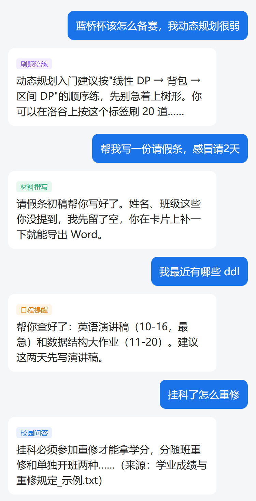
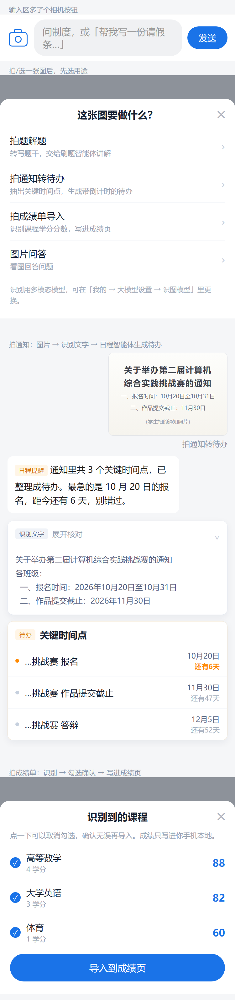
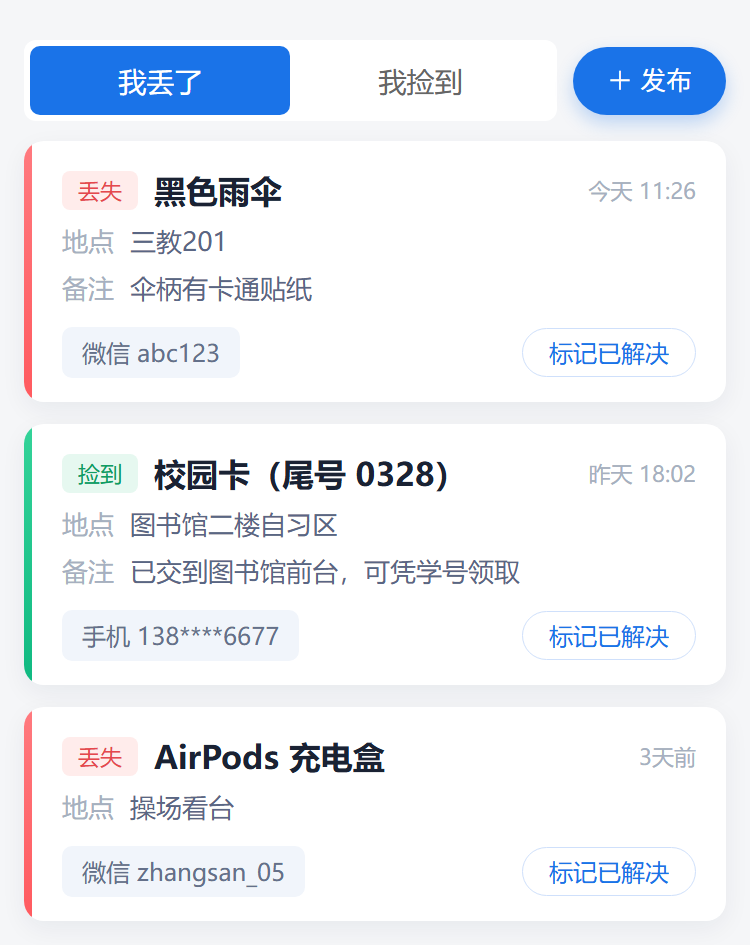
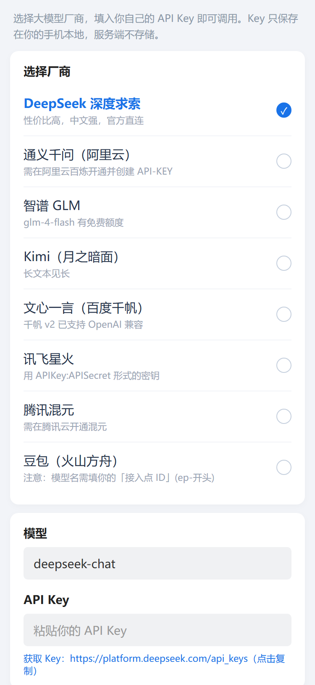
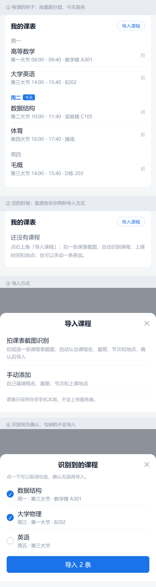
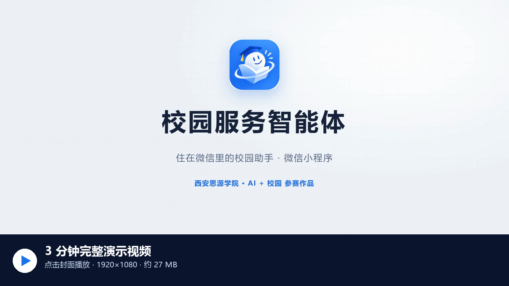
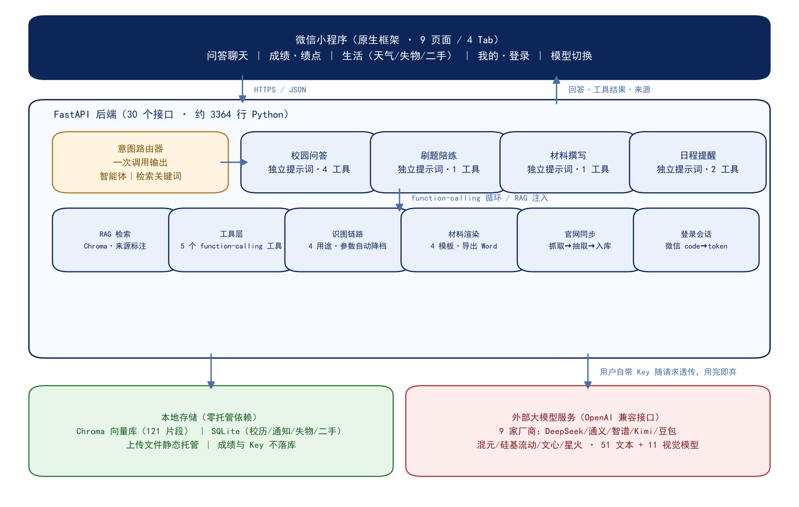

# 校园助手 · 校园服务智能体

> 微信小程序 + FastAPI 后端 · 一个"能答会办"的校园服务智能体
>
> 西安思源学院电子信息工程学院 第二届计算机综合实践挑战赛 · **T4 AI 应用与软件开发赛** 参赛作品

<p>
  
  
  
  
</p>

## 目录

- [一、这是什么](#一这是什么)
- [二、作品截图与演示视频](#二作品截图与演示视频)
- [三、核心功能](#三核心功能)
- [四、技术架构](#四技术架构)
- [五、目录结构](#五目录结构)
- [六、快速开始:从零把项目跑起来](#六快速开始从零把项目跑起来)
- [七、完整使用手册:每个功能怎么用](#七完整使用手册每个功能怎么用)
- [八、功能速查表](#八功能速查表)
- [九、数据、备份与重置](#九数据备份与重置)
- [十、部署与分享](#十部署与分享)
- [十一、主要 API 与调用示例](#十一主要-api-与调用示例)
- [十二、常见问题与排障](#十二常见问题与排障)
- [十三、开发者:换学校 / 换模板 / 换模型](#十三开发者换学校--换模板--换模型)
- [十四、文档与参赛材料](#十四文档与参赛材料)
- [十五、参赛信息](#十五参赛信息)

## 一、这是什么

**校园助手**不是把大模型套一个聊天框。你问一句话，系统会先判断该交给哪个**专职智能体**处理，再带着对应的知识库资料和工具去回答：

- 问「奖学金怎么评」→ **校园问答**智能体，检索校园制度并标注来源；
- 说「帮我写一份请假条，感冒请 2 天」→ **材料撰写**智能体，生成初稿、改字段、导出 Word；
- 问「比赛什么时候报名截止」→ **日程提醒**智能体，把通知里的时间点整理成带倒计时的待办；
- 拍一道题 / 说「我动态规划很弱」→ **刷题陪练**智能体，先讲思路再给答案。

它解决的三个真实问题：

| 痛点 | 做法 |
|---|---|
| 校园信息散落在官网各处，找不到 | 把学校公开文件切块入向量库，问一句就答，**每条回答标注来源**，不编造 |
| 请假条、实训申请等材料格式固定却要反复写 | 模板生成初稿 → 在线改字段 → **一键导出 Word** |
| 绩点、剩余学分、DDL 要自己翻表算 | 自动算加权绩点与等级分布；把通知时间点整理成**带倒计时的待办** |

## 二、作品截图与演示视频

<table>
<tr>
  <td align="center"><br><sub>问答首页 · 四个智能体入口</sub></td>
  <td align="center"><br><sub>多智能体自动分流</sub></td>
  <td align="center"><br><sub>材料生成 → 导出 Word</sub></td>
</tr>
<tr>
  <td align="center"><br><sub>成绩 · 绩点与提分测算</sub></td>
  <td align="center"><br><sub>拍照识别 · 拍题/通知/成绩单</sub></td>
  <td align="center"><br><sub>失物招领</sub></td>
</tr>
<tr>
  <td align="center"><br><sub>多模型切换 · 自带 Key</sub></td>
  <td align="center"><br><sub>学校官网信息同步</sub></td>
  <td align="center"><br><sub>课表 / 日程</sub></td>
</tr>
</table>

### 演示视频

<p align="center">
  <a href="docs/demo-3min.mp4">
    
  </a>
  <br>
  <sub>▶ 点击封面观看 3 分钟完整演示（1920×1080，约 27 MB）</sub>
</p>

## 三、核心功能

### 1. 多智能体协同（路由式）

一次轻量路由同时得到「用哪个智能体」和「检索关键词」，再用该智能体的系统提示词与工具子集执行：

| 智能体 | 职责 | 可用工具 |
|---|---|---|
| 校园问答 | 制度、流程、成绩绩点 | 算绩点、查成绩、查 DDL、生成材料 |
| 刷题陪练 | 蓝桥杯 / 电赛 / 计设赛备赛、讲题 | 查 DDL |
| 材料撰写 | 请假条、实训申请、活动策划、社团申报 | 生成材料 |
| 日程提醒 | 从通知里提取截止时间、生成待办 | 生成待办、查 DDL |

也可以在输入框上方**手动指定**智能体。回答气泡会显示是哪个智能体在应答，答辩时可直接展示分工。

### 2. RAG 知识库问答（可溯源）

- 按**中文小标题切块**，避免把一节内容从中间截断；
- 检索时用「原句 + 路由关键词」多路召回，合并去重；
- 问题涉及时间（什么时候 / 截止 / 赛程）时，含具体日期的片段会**加权**；
- 回答末尾标注「来源：文件名」；资料里没有就明说没找到，**不编造**。

### 3. 工具调用（Agent）

大模型通过 function calling 自主决定调用 5 个工具：`calc_gpa`（算绩点）、`query_scores`（查成绩）、`gen_document`（生成材料）、`gen_todos`（生成待办）、`list_ddls`（查 DDL）。工具层是无状态纯函数，可脱离大模型单独单测。

### 4. 材料生成闭环

`口语描述 → 抽取结构化字段 → 模板渲染 → 人工编辑确认 → 导出 .docx`

内置 4 类模板：请假条、实训申请、活动策划、社团申报。生成的不是一段文字，而是**可编辑字段 + 正式排版**，确认后由后端 `python-docx` 生成 Word 文件。

### 5. 拍照识别（按用途分流）

| 用途 | 处理链路 |
|---|---|
| 拍题解题 | 先逐字转写题干 → 交给刷题智能体讲思路 |
| 拍通知 | 转写正文 → 抽时间点 → 生成带倒计时的待办 |
| 拍成绩单 | 结构化抽取课程/学分/分数 → 用户勾选确认 → 写入本地成绩页 |
| 拍课表 | 识别课程与节次 → 生成课表 |
| 图片问答 | 普通多模态问答 |

识图需要单独配置多模态模型（推荐智谱 `glm-4v-flash`，有免费额度）。识别结果会展示「识别文字」原文供核对。

### 6. 成绩与绩点

录入学分和分数即可自动计算加权平均绩点、加权均分、总学分、等级分布与挂科预警；还可按「目标绩点 + 下学期学分」反推需要考多少分。**成绩只存手机本地**。

### 7. 校园生活

天气与穿衣建议、校历/作息/通知公告快查、课表管理、失物招领（支持拍照，最多 3 张）、二手市场（发布/售出/图片上传）。

### 8. 学校官网信息同步

填入学校官网的文章页网址 → 后端抓取正文 → 大模型抽取成结构化条目，可同步到「校历 / 作息 / 通知公告 / 成绩规则」。抽不到内容时会列出相关栏目建议，支持逐级下钻与返回。

### 9. 多模型可插拔

内置 **9 家**国内主流大模型厂商（DeepSeek、通义千问、智谱、Kimi、豆包、腾讯混元、硅基流动、百度千帆、讯飞星火），统一走 OpenAI 兼容接口。用户可在小程序里选择厂商/模型并填入**自己的 API Key**：

- Key 只保存在用户手机本地（`wx.storage`），随请求发给后端**仅用于当次调用，服务端不落库**；
- 不填 Key 时回退服务端默认模型，开箱即用；
- 厂商注册表见 [`backend/app/providers.py`](backend/app/providers.py)，可自行增删模型。

## 四、技术架构



| 层 | 技术 |
|---|---|
| 小程序端 | 微信小程序原生（WXML / WXSS / JS），9 个页面 / 4 个 Tab |
| 服务层 | FastAPI + Uvicorn，30 个 API；意图路由、RAG、工具循环、多模态调度、网页抽取 |
| 数据层 | Chroma 本地向量库 + SQLite（校历/通知/失物/二手/用户）+ 本地文件静态托管 |
| 模型层 | OpenAI 兼容接口，9 家厂商；文本模型与视觉模型分开配置 |

**一次问答的流程：**

```
用户输入
  → 意图路由（选智能体 + 提关键词）
  → RAG 检索（Chroma top-k，时间意图加权）
  → 组装系统提示 + 上下文 + 工具 schema
  → 大模型 function calling 循环（可多次调用工具）
  → 返回答案 + 来源 + 工具结果卡片（待办 / 材料）
```

## 五、目录结构

```
campus-agent/
├─ backend/                    FastAPI 后端
│  ├─ app/
│  │  ├─ main.py               30 个 API 入口
│  │  ├─ agent.py              Agent 核心：意图路由 + RAG 注入 + function-calling 循环
│  │  ├─ agent_defs.py         4 个专职智能体的系统提示与工具子集
│  │  ├─ tools/__init__.py     5 个工具 + JSON Schema + 注册表
│  │  ├─ providers.py          9 家大模型厂商注册表（OpenAI 兼容）
│  │  ├─ vision.py             拍照识别：5 种用途、参数自动降档
│  │  ├─ documents.py          材料模板 + 渲染 + 导出 .docx
│  │  ├─ files.py              上传文件解析（PDF / Word / 文本）
│  │  ├─ school_sync.py        官网抓取 + 大模型结构化抽取
│  │  ├─ life.py               天气 / 失物招领
│  │  ├─ market.py             二手市场 + 图片上传
│  │  ├─ auth.py               微信登录 code→openid→token（未配密钥时演示模式）
│  │  └─ config.py             从 .env 读取配置
│  ├─ rag/store.py             Chroma：切块 / 入库 / 检索
│  ├─ scripts/ingest.py        批量导入 data/docs/ 校园文档
│  ├─ tests/test_tools.py      工具层单元测试（9 条，纯逻辑可复现）
│  └─ data/docs/               示例校园文档（使用前请替换为学校官方文件）
├─ miniprogram/                微信原生小程序
│  ├─ pages/chat/              问答（核心页：智能体、来源、材料卡、拍照、文件）
│  ├─ pages/scores/            成绩录入 + 绩点计算
│  ├─ pages/life/              生活：天气 / 校历 / 课表 / 失物 / 二手
│  ├─ pages/model/             大模型设置（厂商 + Key + 识图模型）
│  ├─ pages/mine/              登录与个人中心
│  └─ pages/{splash,help,about,agreement}/
├─ docs/                       设计文档、截图、演示视频、AI 使用声明
├─ 启动后端.bat                Windows 一键启动后端
├─ 穿透-启动.bat               后端 + cpolar 内网穿透
├─ project.config.json         微信开发者工具项目配置
└─ README.md
```

## 六、快速开始:从零把项目跑起来

### 6.0 先看最快路径

如果你已经装好 Python 和微信开发者工具，5 分钟就能跑起来：

```bash
# 1. 后端
cd backend
python -m venv .venv
# Windows CMD: .venv\Scripts\activate
# Windows PowerShell: .venv\Scripts\Activate.ps1
# macOS / Linux / Git Bash: source .venv/bin/activate
# Windows Git Bash: source .venv/Scripts/activate
pip install -r requirements.txt
# Windows CMD: copy .env.example .env
# macOS / Linux / Git Bash: cp .env.example .env
# 编辑 .env，填入 LLM_API_KEY

# 2. 知识库
python scripts/ingest.py

# 3. 启动
uvicorn app.main:app --reload     # 或双击根目录「启动后端.bat」
```

然后微信开发者工具导入仓库根目录 → 关闭域名校验 → 我的 → 服务器地址填 `http://127.0.0.1:8000` → 测试连接 → 编译。

下面是每一步的详细说明。

### 6.1 准备清单

| 项目 | 要求 | 说明 |
|---|---|---|
| 操作系统 | Windows 10/11、macOS、Linux | 本项目主要在 Windows 11 上开发 |
| Python | 3.10–3.12，推荐 3.11 | 开发与测试使用 3.11.9 |
| 微信开发者工具 | 稳定版 | [下载地址](https://developers.weixin.qq.com/miniprogram/dev/devtools/download.html) |
| 小程序 AppID | 正式 AppID 或测试号 | 没有 AppID 可在公众平台申请测试号 |
| 大模型 Key | 任意 OpenAI 兼容厂商 | DeepSeek / 智谱等；也可只在小程序里填 |
| 网络 | 首次导入知识库、天气、官网同步需要联网 | 只在本机问答时，后端与模型调用需要联网 |

### 6.2 安装 Python 与后端依赖

**Windows（推荐在项目根目录打开终端）：**

```bash
cd backend
py -3.11 -m venv .venv

# 三选一，按你用的终端：
# Windows CMD
.venv\Scripts\activate
# Windows PowerShell（若提示禁止运行脚本，先执行下一行）
# Set-ExecutionPolicy -Scope Process -ExecutionPolicy Bypass
.venv\Scripts\Activate.ps1
# Windows Git Bash
source .venv/Scripts/activate

python -m pip install -U pip
pip install -r requirements.txt
```

**macOS / Linux：**

```bash
cd backend
python3 -m venv .venv
source .venv/bin/activate
python -m pip install -U pip
pip install -r requirements.txt
```

安装完成后自检：

```bash
python -c "import fastapi, chromadb, docx, pypdf; print('依赖 OK')"
```

> 如果 `chromadb` 安装失败，先确认 Python 版本在 3.10–3.12、pip 已升级；Windows 上个别依赖需要较新的 Visual C++ 运行库。

### 6.3 配置大模型 Key

#### 方式 A：配置在后端 `.env`（推荐新手）

```bash
# 仍在 backend 目录
# Windows CMD:
copy .env.example .env
# macOS / Linux / Git Bash:
cp .env.example .env
```

打开 `backend/.env`，最少填这三行：

```ini
LLM_API_KEY=sk-你的密钥
LLM_BASE_URL=https://api.deepseek.com
LLM_MODEL=deepseek-chat
```

**以 DeepSeek 为例拿 Key：**

1. 打开 <https://platform.deepseek.com/api_keys>，注册/登录；
2. 「API keys」→ 创建 API key；
3. 复制以 `sk-` 开头的字符串，粘贴到 `LLM_API_KEY`；
4. 保存 `.env`，重启后端。

#### 方式 B：在小程序里填自己的 Key

不配 `.env` 也能用：打开小程序 →「我的」→「大模型设置」→ 选厂商、选模型、粘贴 Key → 保存。请求时 Key 随请求发给后端，仅用于当次调用，服务端不落库。

#### 完整环境变量说明

| 变量 | 必填 | 默认值 | 说明 |
|---|---|---|---|
| `LLM_API_KEY` | 是* | 空 | 文本大模型 Key；小程序自带 Key 时可不填 |
| `LLM_BASE_URL` | 否 | `https://api.deepseek.com` | OpenAI 兼容接口地址 |
| `LLM_MODEL` | 否 | `deepseek-chat` | 默认文本模型 |
| `VISION_API_KEY` | 否 | 空 | 服务端识图 Key；不填则要求用户在小程序里配识图模型 |
| `VISION_BASE_URL` | 否 | 智谱地址 | 多模态接口地址 |
| `VISION_MODEL` | 否 | `glm-4v-flash` | 默认识图模型 |
| `WX_APPID` | 否 | 空 | 微信小程序 AppID；不填走游客/演示登录 |
| `WX_SECRET` | 否 | 空 | 微信小程序 Secret |
| `CHROMA_DIR` | 否 | `./data/chroma` | 向量库目录 |
| `RAG_COLLECTION` | 否 | `campus_docs` | 向量库集合名 |
| `RAG_TOP_K` | 否 | `4` | 每次检索返回的片段数 |
| `EMBEDDING_API_KEY` 等 | 否 | 空 | 想用远程嵌入模型时配置；默认用本地 ONNX 模型 |
| `APP_HOST` / `APP_PORT` | 否 | `0.0.0.0` / `8000` | 服务监听地址与端口 |

> `.env` 已加入 `.gitignore`，不会提交到仓库。不要把真实 Key 写进代码或 README。

### 6.4 导入校园知识库

把学校公开的制度、办事流程、学籍规定等文档放进：

```
backend/data/docs/
```

**支持的格式：** `.txt`、`.md`、`.pdf`（PDF 需要带文字层；扫描件/截图请用拍照识别）。
**不支持：** `.docx`、`.doc`、Excel、PPT、压缩包。Word 文档请先另存为 PDF 或 TXT 再导入。

执行导入：

```bash
# backend 目录、虚拟环境已激活
python scripts/ingest.py
```

终端会逐个打印每个文件切了多少块，最后给出总片段数。**首次运行会下载 Chroma 的本地嵌入模型，需要联网，请耐心等待。**

替换或新增文档后，建议先清空再重建：

```bash
python scripts/ingest.py --reset
```

验证：

```bash
# 启动后端后
curl http://127.0.0.1:8000/health
# 返回 {"ok":true,"docs_indexed":121}
```

`docs_indexed` 大于 0 就说明知识库已就绪。小程序问答页顶部也会显示「已收录 X 篇资料 · Y 个知识片段」。

### 6.5 启动后端

```bash
# backend 目录
uvicorn app.main:app --reload
```

看到类似输出即成功：

```
Uvicorn running on http://127.0.0.1:8000 (Press CTRL+C to quit)
```

- 健康检查：<http://127.0.0.1:8000/health>
- 交互式 API 文档：<http://127.0.0.1:8000/docs>
- **这个终端窗口不能关**；关掉后小程序就连不上后端。

**Windows 一键启动：** 双击根目录 `启动后端.bat`。它会自动进入虚拟环境、打印本机局域网 IP，并以 `0.0.0.0:8000` 启动，手机可以直接访问。

**端口被占用：** 改用 `uvicorn app.main:app --reload --port 8001`，同时把小程序「服务器地址」改成对应端口。

### 6.6 打开小程序

1. 微信开发者工具 → **导入项目** → 选择仓库根目录 `campus-agent/`（注意不是 `miniprogram/`）。
2. 填入自己的 AppID；没有可用测试号。
3. 打开 **详情 → 本地设置**，勾选「不校验合法域名、web-view（业务域名）、TLS 版本以及 HTTPS 证书」。
4. 配置后端地址，二选一：
   - 改 [`miniprogram/config.js`](miniprogram/config.js) 的 `API_BASE`（会打包进代码，影响所有使用者）；
   - 或在小程序里「我的 → 服务器地址」临时改（只存本机，旁边有「测试连接」）。
5. 编译。首次进入是启动页，随后进入问答页。

> 注意：仓库里的 `config.js` 默认值可能是作者当时的内网穿透地址。本地运行时请改成 `http://127.0.0.1:8000`，或在小程序「我的 → 服务器地址」里覆盖。

本地开发时，开发者工具里用 `http://127.0.0.1:8000` 即可；**真机调试必须换成电脑的局域网 IP**。

### 6.7 真机调试

1. 手机和电脑连**同一个 WiFi**；
2. 启动后端时看终端打印的局域网 IP（如 `http://192.168.1.5:8000`），或用 `ipconfig` 查；
3. 小程序「我的 → 服务器地址」填这个地址 →「测试连接」→ 保存；
4. Windows 防火墙第一次弹窗时选择「允许访问」；如果误点了取消，手动放行 8000 端口：

```powershell
netsh advfirewall firewall add rule name="campus-agent" dir=in action=allow protocol=TCP localport=8000
```

5. 如果学校 WiFi 开了 AP 隔离，设备之间不能互访，可让电脑连手机热点，再用热点网段的新 IP。

### 6.8 让其他同学使用（体验版 / 内网穿透）

**体验版（同一个 WiFi）：**

1. 开发者工具右上角「上传」→ 版本号 `1.0.0` → 确定；
2. 微信公众平台 → 管理 → 版本管理 → 把刚上传的版本「选为体验版本」；
3. 管理 → 成员管理 → 体验成员 → 添加同学的微信号；
4. 同学扫码打开 → 点右上角 **⋯ → 打开调试**（否则微信会拦截未备案域名）；
5. 涉及拍照/相册时，还要在公众平台「设置 → 服务内容声明 → 用户隐私保护指引」里声明「照片或视频信息」和「摄像头」。

**不在同一网络：**

- 用 cpolar / 花生壳把本机 8000 端口映射到公网，再把公网地址填进「我的 → 服务器地址」；
- 详细步骤见 [docs/内网穿透.md](docs/内网穿透.md)；
- 注意：免费穿透地址会变、电脑和穿透窗口必须一直开着；公网地址泄露会消耗你的模型额度，测试完及时关闭。

**正式上架的限制：** 需要已备案的 HTTPS 域名、小程序备案，AI 问答还涉及深度合成类目与算法备案（通常只对企业主体开放）。比赛阶段用体验版即可。详见 [docs/体验版发布与测试.md](docs/体验版发布与测试.md)。

### 6.9 跑测试

```bash
cd backend
python -m pytest tests/ -v
# 没装 pytest 时：
python -I tests/test_tools.py
```

共 9 条工具层测试，不依赖大模型和网络，覆盖绩点档位边界、加权绩点、挂科识别、空成绩、按名筛选、材料字段填充、缺字段留空、未知模板、待办排序。

## 七、完整使用手册:每个功能怎么用

### 7.0 第一次使用的 5 个步骤

1. **启动后端**，保持终端窗口开着；
2. 打开小程序，在「我的 → 服务器地址」填后端地址并「测试连接」；
3. 可选：在「我的 → 大模型设置」配置对话模型和识图模型；
4. 可选：在「我的」登录，显示头像昵称；
5. 回到问答页，直接输入问题，或点欢迎区的四个入口。

> 不登录、不填 Key 也能用：后端 `.env` 配了默认模型时，开箱即可问答。

---

### 7.1 问答页

#### 界面组成

| 区域 | 作用 |
|---|---|
| 顶部模型条 | 显示当前模型；点开可切换厂商/模型 |
| 欢迎区 | 空对话时显示四个智能体入口和「大家都在问」 |
| 知识库卡片 | 显示已收录的文档数/片段数，可查看来源文件 |
| 能力按钮 | 输入框上方：问制度 / 写材料 / 查日程 / 刷题 |
| 输入框 | 输入问题；左侧「+」上传图片或文件 |
| 发送按钮 | 发送；回答生成中会变成加载状态 |

#### 自动分流与手动指定

- **自动分流（默认）**：直接输入，后端先做一次轻量路由，判断该由哪个智能体回答。
- **手动指定**：点输入框上方的「问制度 / 写材料 / 查日程 / 刷题」，这一轮强制走对应智能体。
- 回答气泡左上角会显示「校园问答 / 刷题陪练 / 材料撰写 / 日程提醒」，可以直观看到是谁在答。

#### 回答里的来源与过程

- 制度类回答末尾会出现「来源：文件名」；资料里没有时，会明确说「资料里没找到」，不会编造。
- 等待回答时会显示处理流程：判断智能体 → 检索知识库 → 组织回答。
- 回答下方会给出 2–3 个追问建议，点一下即可继续。
- 长按某条消息可以复制文字。
- 当前对话只在页面内保留；重新进入小程序/刷新页面会清空，重要内容请及时复制。

#### 示例问法

| 想做什么 | 直接这样问 |
|---|---|
| 问制度 | 「挂科了怎么重修？」「转专业需要什么条件？」「奖学金怎么评？」 |
| 写材料 | 「帮我写一份请假条：感冒发烧，请 2 天，从 11 月 5 日开始」 |
| 查日程 | 「计算机挑战赛报名什么时候截止？」「最近有哪些要交的材料？」 |
| 刷题 | 「出两道动态规划的题给我练练」「讲讲这道题的思路」 |
| 算绩点 | 「帮我算一下绩点」「我哪门课挂科了？」 |

#### 上传文件

点输入框左侧「+」→「上传文件」，一次最多选 10 个文件。

- **支持**：PDF、`.docx`、TXT/MD/CSV/JSON、常见代码文件；
- **单个文件上限 10 MB，单文件最多读取 6000 字，一次提问合计最多 18000 字**，超出会按顺序截断并提示；
- **不支持**：`.doc` 老格式、Excel、PPT、压缩包、音视频；
- 扫描版 PDF 读不出文字时，会提示改用拍照识别；
- 文件解析结果会挂在输入框上方，后续提问会继续带着；点「全部移除」可清掉。

#### 拍照识别入口

输入框左侧「+」→「拍照或从相册选图」→ 选图后选择用途：

| 用途 | 会做什么 |
|---|---|
| 拍题解题 | 先转写题干，再交给刷题智能体讲思路 |
| 拍通知转待办 | 抽取时间点，生成带倒计时的待办卡片 |
| 拍成绩单导入 | 识别课程/学分/分数，勾选确认后写入成绩页 |
| 图片问答 | 看图回答你的问题 |

> 课表拍照识别不在这个入口，在「生活 → 我的课表 → 拍课表截图识别」。

#### 切换模型

点顶部模型条 → 选厂商/模型/填 Key → 保存。详见 [7.10 多模型与 Key 管理](#710-多模型与-key-管理)。

---

### 7.2 材料生成与导出 Word

#### 支持的模板

| 模板 | 字段数 | 典型用途 |
|---|---|---|
| 请假条 | 9 | 病假、事假、离校申请 |
| 实训申请 | 10 | 学生实训/实习申请审批表 |
| 活动策划 | 11 | 社团活动、班级活动策划书 |
| 社团申报 | 10 | 学生社团成立申报书 |

#### 操作步骤

1. **进入**：点欢迎区「写材料」，或输入框上方「写材料」，或直接打字描述。点「写材料」会弹出模板选择。
2. **描述需求**：尽量说清时间、事由、天数、地点等。例如：
   ```
   帮我写一份请假条：感冒发烧请 2 天，从 11 月 5 日开始
   帮我写一份活动策划：校园编程兴趣小组招新
   ```
3. **生成初稿**：AI 会把口语描述抽成结构化字段，缺的字段留空，不编造内容。
4. **编辑字段**：在材料卡片上点「编辑字段」，把姓名、班级、日期、去向、联系方式等改成自己的；点「保存修改」后正文会重新渲染。
5. **导出 Word**：点「导出 Word」→ 后端生成 `.docx` → 小程序下载并用文档查看器打开。右上角菜单可以转发到微信、保存到手机或用其他应用打开。

#### 注意事项

- 生成的是**初稿**，提交前请自己核对事实、格式和签章要求；
- 创意类/学术类材料（项目申报书、作品摘要等）智能体只梳理框架和要点，不代写全文；
- 「我的 → 我生成的材料」只记录**材料标题**，不保存正文；需要留档请及时导出 Word；
- 模板字段与正文在 [`backend/app/documents.py`](backend/app/documents.py) 的 `TEMPLATES` 中，可按学校真实表格替换。

---

### 7.3 拍照识别

#### 先配置识图模型

看图需要多模态模型，DeepSeek 等纯文本模型看不了图。二选一：

- **小程序里配**：我的 → 大模型设置 → 「识图模型」标签 → 选厂商（推荐智谱）→ 选 `glm-4v-flash`（有免费额度）→ 填 Key → 保存；
- **后端配**：在 `.env` 填 `VISION_API_KEY` / `VISION_BASE_URL` / `VISION_MODEL`，重启后端。

对话模型和识图模型是分开配置的，互不影响。

#### 四种对话内用途

| 用途 | 操作 | 结果 |
|---|---|---|
| 拍题解题 | 拍照/选图 → 拍题解题 | 先转写题干，再讲思路；不会一上来直接报答案 |
| 拍通知转待办 | 拍照/选图 → 拍通知转待办 | 抽出关键时间点，生成「还有几天」的待办卡片，最急一项标红 |
| 拍成绩单导入 | 拍照/选图 → 拍成绩单导入 | 识别课程/学分/分数 → 勾选确认 → 导入成绩页 |
| 图片问答 | 可先在输入框打字，再选图 → 图片问答 | 结合文字和图片回答 |

#### 拍课表

生活页 →「我的课表」→「拍课表截图识别」→ 选图 → 识别课程 → 勾选要导入的课 → 导入课表。

#### 核对识别结果

- 回答上方会有「识别文字」卡片，点「展开核对」可以看到模型从图里读出的原文；
- 拍成绩单时，导入前会弹出课程列表，可取消误识别的行；
- 等级制成绩会换算成百分制：优秀 90、良好 82、中等 75、及格 62、合格/通过 60；不合格/未通过 50。

#### 拍照建议与权限

- 正对文件、光线充足、避免反光和大角度倾斜；
- 题干、选项、图表都要完整入镜；
- 体验版第一次拍照需要微信隐私授权；如果提示 `api scope is not declared in the privacy agreement`，按 [docs/体验版发布与测试.md](docs/体验版发布与测试.md) 配置隐私保护指引。

---

### 7.4 成绩与绩点

#### 录入与删除

1. 底部 Tab 进入「成绩」；
2. 「录入成绩」填课程名、学分、分数（三项都必填）→「添加」；
3. 课程列表按分数从高到低显示，点右侧「删」可删除，删除前会确认。

#### 自动计算

| 指标 | 说明 |
|---|---|
| 平均绩点 | 按学分加权的 4.0 制绩点 |
| 加权均分 | 按学分加权的百分制均分 |
| 总学分 | 所有已录入课程学分之和 |
| 成绩分布 | 优秀/良好/中等/及格/不及格五档柱状分布 |
| 挂科预警 | 低于 60 分的课程会在顶部标出 |

**绩点换算表（前后端一致）：**

| 分数 | 绩点 | 分数 | 绩点 |
|---|---|---|---|
| ≥90 | 4.0 | 72–74 | 2.3 |
| 85–89 | 3.7 | 68–71 | 2.0 |
| 82–84 | 3.3 | 64–67 | 1.5 |
| 78–81 | 3.0 | 60–63 | 1.0 |
| 75–77 | 2.7 | <60 | 0 |

**等级分布阈值：** 优秀 ≥90，良好 ≥80，中等 ≥70，及格 ≥60，其余不及格。

#### 提分测算

填「目标绩点」和「下学期学分」，系统按

```
所需下学期平均绩点 = (目标绩点 × (当前总学分 + 下学期学分) − 当前绩点 × 当前总学分) ÷ 下学期学分
```

反推所需均分；如果即使全部拿 4.0 也达不到，会直接提示差距过大。

#### 学校成绩规则

「学校成绩规则」卡片 →「同步官网」→ 填学校教务/学籍规定文章页 → 同步。同步的是学校公开的绩点算法、等级划分、补考重修、奖学金评定等条文，方便对照本校规则。

#### 让 AI 分析

点「让 AI 分析我的成绩，给提升建议」，会带着当前绩点、均分、门数、挂科情况跳到问答页。

> 成绩只存手机 `wx.storage`，不爬教务系统、后端不落库。

---

### 7.5 课表

入口：生活页 →「我的课表」。

#### 手动添加

1. 点「手动添加」；
2. 填课程名、星期、节次、上课地点、周次（可不填）；
3. 点「添加并继续」可以连续加下一门，或「添加后关闭」；
4. 同一天同一节次已有同名课程时会提示重复。

#### 拍课表导入

1. 点「拍课表截图识别」；
2. 选择课表截图（需要先配置识图模型）；
3. 识别结果以列表展示，勾选要导入的课程；
4. 点「导入 N 条」写入本地课表；已存在的课程会自动跳过。

#### 删除与查看

课程按星期分组展示；点课程右侧垃圾桶图标可删除（会确认）。课表只存本机，不会上传服务器；「清除本地数据」**不会**清掉课表。

---

### 7.6 日程与待办

#### 怎么生成

- 直接问：「计算机挑战赛报名什么时候截止？」「最近有哪些要交的材料？」
- 点「查日程」能力按钮；
- 拍照 →「拍通知转待办」，识别通知里的时间点。

#### 待办卡片

回答下方会出现「待办 · 关键时间点」卡片，每条包含：

- 事项标题；
- 截止日期（如「11月30日」）；
- 倒计时（「还有 6 天」「今天」「已过」）；
- 7 天内的事项会标红提醒；
- 有备注时会显示说明。

> 当前版本的待办卡片是**对话内展示**，不会自动写入系统日历或独立待办列表；需要留存请截图或长按复制。

---

### 7.7 生活页

生活页有三个 Tab：**天气·校历 / 失物招领 / 二手市场**。

#### 天气与校历

- 打开生活页自动请求天气，显示温度、天气、湿度、风力、降雨概率，并给出穿衣/出行建议；
- 天气城市由后端配置，默认西安；换学校时改 [`backend/app/life.py`](backend/app/life.py) 顶部的 `CITY_LAT / CITY_LON / CITY_NAME`；
- 校历、作息、通知公告卡片显示已同步的内容；没同步时显示默认校历/作息示例。

#### 失物招领

1. 切到「失物招领」Tab；
2. 选「我丢了」或「我捡到」；
3. 填物品名称、地点、联系方式、详细描述，可加最多 3 张照片；
4. 发布后出现在列表；找到后可「标记已解决」；
5. 点条目可查看详情，联系方式可复制。

#### 二手市场

1. 切到「二手市场」Tab；
2. 「发布闲置」→ 选分类（教材书籍/数码电子/生活用品/服饰鞋包/运动户外/其他）→ 填标题、价格、原价、描述、联系方式 → 加最多 3 张实物图；
3. 发布后在列表按分类浏览；
4. 点商品看详情，可复制卖家联系方式；
5. 卖出后在详情里「标记已售出」。

> 登录不是使用前提；不登录也能问答、算绩点、发布内容。登录主要用于显示微信头像昵称。发布内容请勿包含身份证号、银行卡号等敏感信息。

---

### 7.8 学校官网同步

#### 入口

- 生活页「天气·校历」里的校历/作息/通知公告卡片 →「同步官网」；
- 成绩页「学校成绩规则」卡片 →「同步官网」。

#### 操作步骤

1. 点「同步官网」；
2. 选择同步到哪一栏：生活页可选校历/作息/通知公告，成绩页固定为成绩规则；
3. 填学校官网网址，或以「校名」搜索院校后点一条自动填入官网；
4. 点「同步」，等待抓取 + 大模型抽取；
5. 成功后卡片会显示新的条目，生活页会播放校徽过场动画。

#### 网址怎么填

- **必须填有正文的具体文章页**，例如某份学籍管理规定、某个放假通知的详情页；
- 不要填学校首页或纯列表页——页面上只有链接没有正文，会提示「已同步 0 条」；
- 如果这页确实只有链接，下方会给出相关栏目建议，点一下可直接用它再同步；
- 下钻后可以用「‹ 返回上一级」退回去重选，网址输入框会跟着回退。

#### 注意事项

- 同步内容是学校公开发布的信息，AI 抽取可能漏细节；毕业学分、重修规定等关键事项请以官网原文为准；
- 同一类别再次同步会按类别覆盖旧条目；
- 抓取只支持静态 HTML，不做 JS 渲染；正文不足 50 字会被判定为 JS 渲染页并提示；
- 内置院校名单 2600+ 所，其中 580+ 所有官网链接；没有链接的学校可手动填。

---

### 7.9 我的页

| 功能 | 说明 |
|---|---|
| 登录 | 可选；微信 `wx.login` 换 openid，未配 `WX_APPID/WX_SECRET` 时走后端演示模式 |
| 头像/昵称 | 登录后可改头像和昵称；点昵称直接编辑 |
| 数据概览 | 已录课程、我的闲置、我的失物、生成材料，点数字跳到对应位置 |
| 大模型设置 | 对话模型 / 识图模型两个标签页，选厂商、模型、填 Key |
| 服务器地址 | 临时改后端地址，只存本机，带「测试连接」 |
| 清除本地数据 | 清空成绩、DDL 记录、「我发布的」记录；**不清**课表、模型配置、服务器地址、登录态、已同步的官网信息 |
| 服务协议/隐私政策 | 查看数据使用说明 |
| 使用帮助 | 内置功能说明与常见问题 |
| 关于本作品 | 作品定位、技术栈、参赛信息 |
| 意见反馈 | 当前为示例邮箱，提交前请替换成本团队联系方式 |

---

### 7.10 多模型与 Key 管理

#### 支持的 9 家厂商

| 厂商 | Key 申请地址 | 备注 |
|---|---|---|
| DeepSeek 深度求索 | <https://platform.deepseek.com/api_keys> | 推荐入门，性价比高 |
| 通义千问（阿里云） | <https://bailian.console.aliyun.com/> | 支持视觉模型 |
| 智谱 GLM | <https://open.bigmodel.cn/usercenter/apikeys> | `glm-4v-flash` 有免费额度，推荐识图 |
| Kimi（月之暗面） | <https://platform.moonshot.cn/console/api-keys> | 长文本 |
| 豆包（火山方舟） | <https://console.volcengine.com/ark> | 模型名可能是接入点 ID |
| 腾讯混元 | <https://console.cloud.tencent.com/hunyuan/api-key> | — |
| 硅基流动 | <https://cloud.siliconflow.cn/account/ak> | 多模型聚合 |
| 文心一言（百度千帆） | <https://console.bce.baidu.com/qianfan/> | — |
| 讯飞星火 | <https://console.xfyun.cn/> | — |

#### 配置步骤

1. 我的 → 大模型设置；
2. 选「对话模型」或「识图模型」标签；
3. 选厂商；
4. 选内置模型，或点「拉取最新列表」，或手填模型名；
5. 粘 Key →「保存并使用」/「保存识图模型」。

#### 行为说明

- 不填 Key：后端用 `.env` 的默认模型；后端也没配时，问答会提示缺少 Key；
- 填了 Key：优先用用户自己的厂商/模型，Key 只存手机本地，服务端不落库；
- 「使用默认模型」可清掉本地配置，回到服务端默认；
- 识图必须用多模态模型；DeepSeek 纯文本模型不能看图；
- 拉取模型列表失败时，直接手填模型名即可。

## 八、功能速查表

| 我想…… | 去哪里 | 怎么做 |
|---|---|---|
| 问校园制度 | 问答页 | 直接输入，或点「问制度」 |
| 写请假条/实训申请 | 问答页 | 点「写材料」→ 选模板 → 描述事由 |
| 导出 Word | 问答页材料卡片 | 「编辑字段」改完 →「导出 Word」 |
| 拍题问题 | 问答页 | 「+」→ 选图 →「拍题解题」 |
| 拍通知生成待办 | 问答页 | 「+」→ 选图 →「拍通知转待办」 |
| 拍成绩单导入 | 问答页 | 「+」→ 选图 →「拍成绩单导入」→ 勾选导入 |
| 拍课表导入 | 生活页 | 我的课表 →「拍课表截图识别」 |
| 算绩点 | 成绩页 | 录入课程名/学分/分数 |
| 目标绩点反推 | 成绩页 | 填目标绩点 + 下学期学分 |
| 看天气 | 生活页 | 默认打开即显示 |
| 同步校历/作息/通知 | 生活页 | 卡片「同步官网」→ 填文章页网址 |
| 同步成绩规则 | 成绩页 | 「学校成绩规则」→「同步官网」 |
| 发失物招领 | 生活页 | 失物招领 Tab → 我丢了/我捡到 |
| 发二手闲置 | 生活页 | 二手市场 Tab → 发布闲置 |
| 换大模型 | 问答页/我的 | 顶部模型条 / 大模型设置 |
| 改后端地址 | 我的 | 服务器地址 → 测试连接 → 保存 |
| 清本地成绩/发布记录 | 我的 | 清除本地数据 |

## 九、数据、备份与重置

### 9.1 小程序本地存了什么

| 存储键 | 内容 | 清除本地数据会删吗 |
|---|---|---|
| `courses` | 课程成绩 | 会 |
| `ddls` | 本地 DDL 记录 | 会 |
| `timetable` | 课表 | **不会** |
| `mine_market` / `mine_lost` / `mine_doc` | 我发布的闲置/失物、生成材料标题 | 会 |
| `llm` / `visionLlm` | 对话/识图模型配置与 Key | **不会** |
| `apiBase` | 服务器地址 | **不会** |
| `user` | 登录态 | **不会** |
| `modelGuideSeen` | 模型设置页引导是否看过 | **不会** |

> 清理微信缓存或删除小程序会清掉全部本地数据，且无法恢复。重要成绩、材料请提前导出或截图。

### 9.2 后端存了什么

| 路径 | 内容 |
|---|---|
| `backend/.env` | 服务端密钥与配置（不进 git） |
| `backend/data/docs/` | 知识库原始文档 |
| `backend/data/chroma/` | 向量库（可重建） |
| `backend/data/life.db` / `market.db` / `users.db` / `school.db` | 失物、二手、用户、官网同步数据 |
| `backend/data/uploads/` | 二手/失物图片 |
| `backend/data/exports/` | 导出的 Word 文件（运行时可清理） |

### 9.3 备份与迁移

- **换电脑/重装**：复制整个 `backend/data/` 和 `backend/.env` 即可；`chroma/` 可保留，也可用 `scripts/ingest.py --reset` 重建；
- **备份知识库**：备份 `data/docs/` 原始文件最重要，向量库随时可重建；
- **备份业务数据**：备份 `data/*.db` 和 `data/uploads/`；
- **小程序数据**：只能通过导出 Word、截图或手动记录保留；服务端不保存成绩。

### 9.4 重置

```bash
# 只重建知识库
cd backend
python scripts/ingest.py --reset

# 清空知识库（不动业务库）
# 停止后端后删除 backend/data/chroma/，再重新 ingest

# 完全重置业务数据（谨慎）
# 停止后端，备份后删除：
#   backend/data/*.db
#   backend/data/uploads/
#   backend/data/exports/
# 再重启后端（会自动建表），然后重新 ingest
```

## 十、部署与分享

| 方式 | 适用场景 | 要点 |
|---|---|---|
| 本机 | 自己开发调试 | `uvicorn`，小程序地址 `127.0.0.1:8000` |
| 局域网 | 同 WiFi 的手机/同学体验 | `0.0.0.0:8000`，填电脑局域网 IP，防火墙放行 8000 |
| 内网穿透 | 同学用流量/外网访问 | cpolar/花生壳映射 8000，把公网地址填进小程序 |
| 体验版 | 比赛 20 人测试 | 上传 → 选为体验版 → 加体验成员 → 同学「打开调试」 |
| 正式上架 | 长期公开使用 | 需备案域名、小程序备案、AI 类目与算法备案，通常要企业主体 |

**安全提醒：**

- 公网穿透会把 `/chat` 暴露给任何人，别人调用会消耗你的模型额度；测试完关闭穿透；
- 不要把 `.env`、API Key、数据库文件提交到公开仓库；
- 生产环境应收紧 CORS、给写接口加会话校验（当前为开发配置）。

## 十一、主要 API 与调用示例

### 11.1 接口一览

| 方法 | 路径 | 说明 |
|---|---|---|
| GET | `/health` | 健康检查与知识库片段数 |
| GET | `/providers` | 可选大模型厂商与模型列表 |
| POST | `/providers/models` | 拉取某厂商的可用模型 |
| GET | `/kb/stats` | 知识库统计 |
| POST | `/chat` | 核心对话：路由 + RAG + 工具调用 |
| POST | `/chat/vision` | 拍照识别（5 种用途） |
| POST | `/file/parse` | 解析上传的 PDF / Word / 文本 |
| POST | `/rag/upload` | 上传文档并入库 |
| POST | `/doc/render` | 按模板渲染材料 |
| POST | `/doc/export` | 导出材料为 .docx |
| GET | `/life/weather` | 天气与建议 |
| POST/GET | `/life/lostfound` | 发布 / 查询失物招领 |
| POST | `/life/lostfound/{id}/close` | 标记失物已解决 |
| GET/POST | `/life/market` | 二手市场列表 / 发布 |
| POST | `/life/market/{id}/sold` | 标记已售出 |
| POST | `/life/market/upload` | 上传商品图片 |
| GET | `/school/search` | 按校名搜院校 |
| POST | `/school/sync` | 抓取并同步学校官网信息 |
| GET | `/school/items` | 查询已同步的官网条目 |
| POST | `/auth/login` | 微信登录换取会话 token |
| GET | `/auth/me` | 当前登录用户 |

完整参数以运行后的 <http://127.0.0.1:8000/docs> 为准。

### 11.2 curl 示例

**健康检查：**

```bash
curl http://127.0.0.1:8000/health
```

**问答：**

```bash
curl -X POST http://127.0.0.1:8000/chat \
  -H "Content-Type: application/json" \
  -d '{
    "message": "挂科了怎么重修？",
    "history": [],
    "courses": [{"name":"高等数学","credit":4,"score":92}],
    "ddls": [],
    "user_name": "同学"
  }'
```

**生成材料：**

```bash
curl -X POST http://127.0.0.1:8000/doc/render \
  -H "Content-Type: application/json" \
  -d '{
    "doc_type": "请假条",
    "fields": {"姓名":"张三","请假事由":"感冒发烧","请假天数":"2"}
  }'
```

**导出 Word：**

```bash
curl -X POST http://127.0.0.1:8000/doc/export \
  -H "Content-Type: application/json" \
  -d '{"title":"请假条","text":"请假条\n\n尊敬的辅导员：\n……"}'
# 返回 {"ok":true,"url":"/exports/xxxx.docx"}
```

**同步官网：**

```bash
curl -X POST http://127.0.0.1:8000/school/sync \
  -H "Content-Type: application/json" \
  -d '{"category":"校历","url":"https://www.example.edu.cn/xiaoli.html"}'
```

> 用 Git Bash / PowerShell 时注意 JSON 引号转义；在 Windows CMD 里建议用文件传参或直接用 `/docs` 页面调试。

## 十二、常见问题与排障

### 启动与连接

**Q：`python` 不是内部或外部命令？**
安装 Python 时勾选「Add Python to PATH」，或改用 `py -3.11`。装完重开终端。

**Q：PowerShell 不能激活虚拟环境？**
执行 `Set-ExecutionPolicy -Scope Process -ExecutionPolicy Bypass`，再 `.venv\Scripts\Activate.ps1`；或者直接用 CMD/Git Bash。

**Q：`pip install` 很慢或失败？**
换镜像（如 `pip install -r requirements.txt -i https://pypi.tuna.tsinghua.edu.cn/simple`）；确认 Python 3.10–3.12；升级 pip。

**Q：`/health` 返回 `docs_indexed: 0`？**
还没导入知识库，执行 `python scripts/ingest.py`。首次导入需联网下载嵌入模型。

**Q：首次 ingest 卡住/报网络错误？**
嵌入模型需要下载。检查网络/代理；或配置 `EMBEDDING_*` 使用远程嵌入接口。

**Q：8000 端口被占用？**
`uvicorn app.main:app --reload --port 8001`，并同步改小程序服务器地址。

**Q：小程序一直转圈 / 连不上后端？**
依次检查：后端窗口是否还开着 → 手机与电脑同一 WiFi → 服务器地址是否为局域网 IP →「测试连接」→ Windows 防火墙放行 8000 → 体验版是否点「⋯ → 打开调试」。

**Q：手机能打开 `/health`，小程序却连不上？**
检查小程序「服务器地址」有没有保存成功；体验版必须「打开调试」；确认没有混用 `127.0.0.1`（手机上的 127.0.0.1 指手机自己）。

### 模型与 Key

**Q：提示缺少 API Key / 模型调用失败？**
在 `.env` 填 `LLM_API_KEY` 并重启后端，或在「我的 → 大模型设置」填自己的 Key；确认模型名与厂商匹配，账户有余额。

**Q：不填 Key 能用吗？**
后端配了默认 Key 就能用；都没配时，问答会提示缺 Key，但成绩计算、课表、失物/二手等本地功能仍可用。

**Q：Key 会不会泄露？**
Key 只存手机本地，随请求发给后端仅用于当次调用，服务端不落库；仍建议使用自己的 Key 并定期更换。

**Q：换模型后回答变差/变慢？**
不同模型能力不同；可在模型设置页换回默认或换厂商。拉取模型列表失败时手填模型名。

### 知识库与回答

**Q：回答里没有来源？**
可能不是制度类问题，或知识库没有命中。制度类问题会尽量标注来源；没命中会明确说「资料里没找到」。

**Q：回答内容和学校规定不一致？**
先看来源文件是否为最新版本；知识库需要你替换为学校官方文件并重新 ingest。制度类内容以学校正式文件为准。

**Q：怎么换成本校/本学院的知识？**
替换 `backend/data/docs/` 下的文件 → `python scripts/ingest.py --reset`。不需要改代码。

### 拍照与识图

**Q：提示「还没配置识图模型」？**
去「我的 → 大模型设置 → 识图模型」选智谱 `glm-4v-flash` 等并填 Key，或后端配置 `VISION_*`。

**Q：识别不准/漏行？**
正对文件、光线足、避免反光；识别后点「展开核对」看 OCR 原文；关键信息以原件为准。

**Q：拍成绩单导入后分数不对？**
导入前在确认面板取消误识别的行；等级制会按 优秀90/良好82/中等75/及格62/合格60 换算，可导入后手动改。

**Q：拍照报隐私错误？**
体验版需在公众平台配置「照片或视频信息」「摄像头」隐私指引；开发版/体验版可临时在 `app.json` 加 `"__usePrivacyCheck__": false`，正式发布必须靠隐私指引。

### 成绩与材料

**Q：绩点和学校算的不一样？**
本作品使用 10 档 4.0 制换算表，可能与本校规则不同。可在「成绩页 → 学校成绩规则」同步本校规则；代码层面改两处：后端 `tools/__init__.py` 的 `_score_to_gpa` 和小程序 `scores.js` 的 `scoreToGpa`/`levelOf`。

**Q：导出的 Word 找不到？**
导出后小程序用文档查看器打开，文件在临时目录；点右上角菜单转发到微信/保存到手机。后端生成的文件在 `backend/data/exports/`，可定期清理。

**Q：材料正文丢了？**
「我生成的材料」只存标题，不存正文；需要回到问答页重新生成并导出。

### 官网同步

**Q：提示「已同步 0 条」？**
填了首页或纯列表页。换成有正文的具体文章页；或点下方「相关栏目」建议下钻。

**Q：同步内容不全/不准？**
AI 抽取可能漏细节；关键事项以官网原文为准。可换更具体的文章页重新同步。

**Q：同步报抓取失败？**
确认网址以 `http(s)://` 开头、页面可公开访问；JS 渲染页、需要登录的页面抓不到。

### 数据与发布

**Q：清理微信缓存后数据没了？**
成绩、课表、发布记录都在手机本地，清理缓存/删除小程序会丢失；服务端不保存成绩。重要数据请提前导出。

**Q：「清除本地数据」清了什么？**
成绩、DDL 记录、我发布的记录；不清课表、模型配置、服务器地址、登录态、已同步的官网信息。

**Q：发布失物/二手需要登录吗？**
当前版本不强制登录；登录主要用于显示头像昵称。发布时请填好联系方式。

**Q：图片上传失败？**
确认后端在运行、`backend/data/uploads/` 可写；体验版检查隐私指引；单次最多 3 张。

## 十三、开发者:换学校 / 换模板 / 换模型

| 想改什么 | 文件 | 做法 |
|---|---|---|
| 换学校知识库 | `backend/data/docs/` | 替换文档 → `python scripts/ingest.py --reset` |
| 改切块规则 | `backend/rag/store.py` | 调整按标题切块/长度/重叠参数 |
| 改绩点换算 | `backend/app/tools/__init__.py` + `miniprogram/pages/scores/scores.js` | 两处同步修改，保持前后端一致 |
| 改成绩等级 | `miniprogram/pages/scores/scores.js` | 改 `levelOf` 与 `LEVELS` |
| 改材料模板 | `backend/app/documents.py` | 改 `TEMPLATES` 的 fields/body；前端 `chat.js` 的 `docTypes` 同步加类型 |
| 加模型厂商 | `backend/app/providers.py` | 往注册表加一段配置（OpenAI 兼容） |
| 改智能体提示词/工具子集 | `backend/app/agent_defs.py` | 改 `AGENTS` 与系统提示 |
| 加工具 | `backend/app/tools/__init__.py` | 写纯函数 + JSON Schema + 注册；补单测 |
| 改天气城市 | `backend/app/life.py` | 改 `CITY_LAT / CITY_LON / CITY_NAME` |
| 更新院校名单 | `backend/scripts/build_university_list.py` | 重新生成 `app/data/universities.json` |
| 改路由逻辑 | `backend/app/agent.py` | 改路由提示词/解析/回落策略 |
| 改小程序页面 | `miniprogram/pages/*` | 改完在开发者工具重新编译；体验版需重新上传 |

**开发约定：**

- 后端改完重启 `uvicorn`；小程序改完重新编译；
- 工具层保持无状态、可单测；不要依赖爬教务系统；
- 不要把密钥写进代码、日志或提交记录；
- 改完跑一遍 `python -m pytest tests/ -v`。

## 十四、文档与参赛材料

| 文件 | 内容 |
|---|---|
| [docs/需求分析与设计文档.docx](docs/需求分析与设计文档.docx) | 需求分析、系统设计、测试与总结 |
| [docs/AI工具使用声明.md](docs/AI工具使用声明.md) | AI 工具使用情况与人工再创作说明 |
| [docs/原创承诺书与AI工具使用声明.docx](docs/原创承诺书与AI工具使用声明.docx) | 参赛承诺书 |
| [docs/项目计划.md](docs/项目计划.md) | 赛程倒排、用户测试组织、答辩要点 |
| [docs/体验版发布与测试.md](docs/体验版发布与测试.md) | 体验版上传、体验成员、隐私指引 |
| [docs/内网穿透.md](docs/内网穿透.md) | cpolar / 花生壳配置 |
| [docs/总体架构图.png](docs/总体架构图.png) | 系统总体架构 |
| [docs/调用时序图.png](docs/调用时序图.png) | 一次问答的调用时序 |

## 十五、参赛信息

| 项 | 内容 |
|---|---|
| 赛道 | T4 · AI 应用与软件开发赛 |
| 作品名称 | 校园服务智能体（校园助手） |
| 选送单位 | 西安思源学院 电子信息工程学院 |
| 团队名称 / 队长 / 指导老师 | 见参赛材料 |

> 本仓库用于学习、参赛展示与技术交流。作品内引用的校园制度文档请以学校官方发布为准；开发过程中使用了 AI 辅助编码，具体情况见《AI 工具使用声明》。
