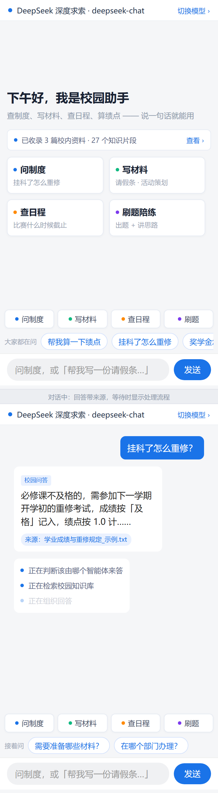
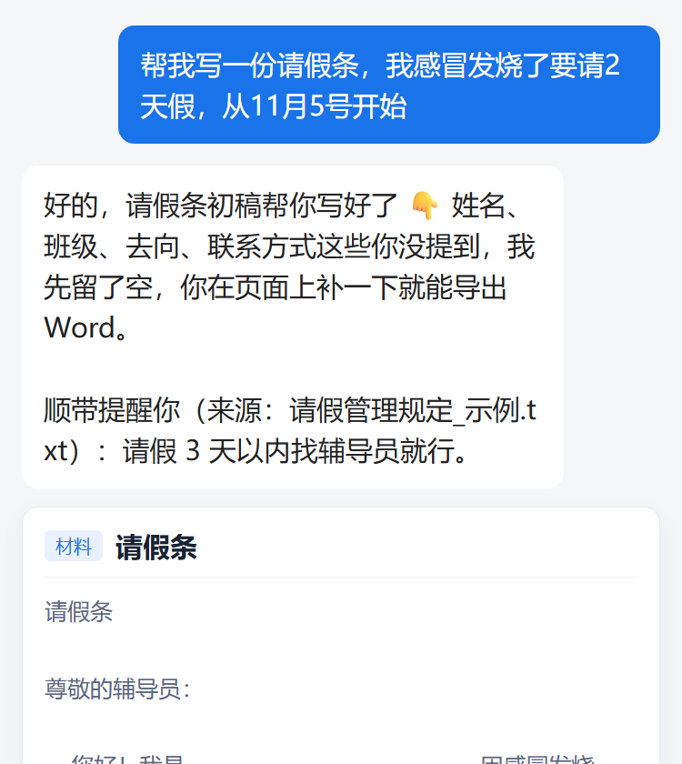
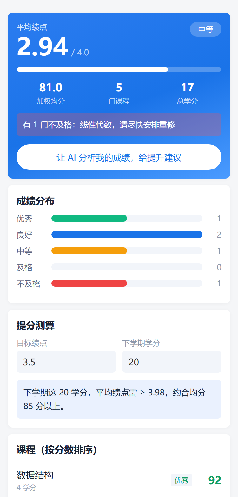
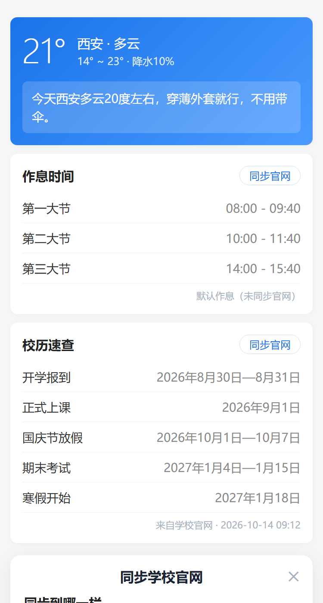

# 校园助手 · 校园服务智能体

> 微信小程序 + FastAPI 后端 · 一个"能答会办"的校园服务智能体
>
> 西安思源学院电子信息工程学院 第二届计算机综合实践挑战赛 · **T4 AI 应用与软件开发赛** 参赛作品

<p>
  
  
  
  
</p>

---

## 一、这是什么

**校园助手**不是把大模型套一个聊天框。你问一句话，系统会先判断该交给哪个**专职智能体**处理，再带着对应的知识库资料和工具去回答：

- 问「奖学金怎么评」→ **校园问答**智能体，检索校园制度并标注来源；
- 说「帮我写一份请假条，感冒请 2 天」→ **材料撰写**智能体，生成初稿、改字段、导出 Word；
- 问「比赛什么时候报名截止」→ **日程提醒**智能体，把通知里的时间点整理成带倒计时的待办；
- 拍一道题 / 说「我动态规划很弱」→ **刷题陪练**智能体，先讲思路再给答案。

它解决的三个真实问题：

| 痛点 | 做法 |
|---|---|
| 校园信息散落在官网各处，找不到 | 把学校公开文件切块入向量库，问一句就答，**每条回答标注来源**，不编造 |
| 请假条、实训申请等材料格式固定却要反复写 | 模板生成初稿 → 在线改字段 → **一键导出 Word** |
| 绩点、剩余学分、DDL 要自己翻表算 | 自动算加权绩点与等级分布；把通知时间点整理成**带倒计时的待办** |

## 二、作品截图

<table>
<tr>
  <td align="center"><br><sub>问答首页 · 四个智能体入口</sub></td>
  <td align="center"><br><sub>多智能体自动分流</sub></td>
  <td align="center"><br><sub>材料生成 → 导出 Word</sub></td>
</tr>
<tr>
  <td align="center"><br><sub>成绩 · 绩点与提分测算</sub></td>
  <td align="center"><br><sub>拍照识别 · 拍题/通知/成绩单</sub></td>
  <td align="center"><br><sub>失物招领</sub></td>
</tr>
<tr>
  <td align="center"><br><sub>多模型切换 · 自带 Key</sub></td>
  <td align="center"><br><sub>学校官网信息同步</sub></td>
  <td align="center"><br><sub>课表 / 日程</sub></td>
</tr>
</table>

## 三、核心功能

### 1. 多智能体协同（路由式）

一次轻量路由同时得到「用哪个智能体」和「检索关键词」，再用该智能体的系统提示词与工具子集执行：

| 智能体 | 职责 | 可用工具 |
|---|---|---|
| 校园问答 | 制度、流程、成绩绩点 | 算绩点、查成绩、查 DDL、生成材料 |
| 刷题陪练 | 蓝桥杯 / 电赛 / 计设赛备赛、讲题 | 查 DDL |
| 材料撰写 | 请假条、实训申请、活动策划、社团申报 | 生成材料 |
| 日程提醒 | 从通知里提取截止时间、生成待办 | 生成待办、查 DDL |

也可以在输入框上方**手动指定**智能体。回答气泡会显示是哪个智能体在应答，答辩时可直接展示分工。

### 2. RAG 知识库问答（可溯源）

- 按**中文小标题切块**，避免把一节内容从中间截断；
- 检索时用「原句 + 路由关键词」多路召回，合并去重；
- 问题涉及时间（什么时候 / 截止 / 赛程）时，含具体日期的片段会**加权**；
- 回答末尾标注「来源：文件名」；资料里没有就明说没找到，**不编造**。

### 3. 工具调用（Agent）

大模型通过 function calling 自主决定调用 5 个工具：`calc_gpa`（算绩点）、`query_scores`（查成绩）、`gen_document`（生成材料）、`gen_todos`（生成待办）、`list_ddls`（查 DDL）。工具层是无状态纯函数，可脱离大模型单独单测。

### 4. 材料生成闭环

`口语描述 → 抽取结构化字段 → 模板渲染 → 人工编辑确认 → 导出 .docx`

内置 4 类模板：请假条、实训申请、活动策划、社团申报。生成的不是一段文字，而是**可编辑字段 + 正式排版**，确认后由后端 `python-docx` 生成 Word 文件。

### 5. 拍照识别（按用途分流）

| 用途 | 处理链路 |
|---|---|
| 拍题解题 | 先逐字转写题干 → 交给刷题智能体讲思路 |
| 拍通知 | 转写正文 → 抽时间点 → 生成带倒计时的待办 |
| 拍成绩单 | 结构化抽取课程/学分/分数 → 用户勾选确认 → 写入本地成绩页 |
| 拍课表 | 识别课程与节次 → 生成课表 |
| 图片问答 | 普通多模态问答 |

识图需要单独配置多模态模型（推荐智谱 `glm-4v-flash`，有免费额度）。识别结果会展示「识别文字」原文供核对。

### 6. 成绩与绩点

录入学分和分数即可自动计算加权平均绩点、加权均分、总学分、等级分布与挂科预警；还可按「目标绩点 + 下学期学分」反推需要考多少分。**成绩只存手机本地**。

### 7. 校园生活

天气与穿衣建议、校历/作息快查、失物招领（支持拍照，最多 3 张）、二手市场（发布/售出/图片上传）。发布类功能需要微信登录。

### 8. 学校官网信息同步

填入学校官网的文章页网址 → 后端抓取正文 → 大模型抽取成结构化条目，可同步到「校历 / 作息 / 通知公告 / 成绩规则」。抽不到内容时会列出相关栏目建议，支持逐级下钻与返回。

### 9. 多模型可插拔

内置 **9 家**国内主流大模型厂商（DeepSeek、通义千问、智谱、Kimi、豆包、腾讯混元、硅基流动、百度千帆、讯飞星火），统一走 OpenAI 兼容接口。用户可在小程序里选择厂商/模型并填入**自己的 API Key**：

- Key 只保存在用户手机本地（`wx.storage`），随请求发给后端**仅用于当次调用，服务端不落库**；
- 不填 Key 时回退服务端默认模型，开箱即用；
- 厂商注册表见 [`backend/app/providers.py`](backend/app/providers.py)，可自行增删模型。

## 四、技术架构


| 层 | 技术 |
|---|---|
| 小程序端 | 微信小程序原生（WXML / WXSS / JS），9 个页面 / 4 个 Tab |
| 服务层 | FastAPI + Uvicorn，30 个 API；意图路由、RAG、工具循环、多模态调度、网页抽取 |
| 数据层 | Chroma 本地向量库 + SQLite（校历/通知/失物/二手/用户）+ 本地文件静态托管 |
| 模型层 | OpenAI 兼容接口，9 家厂商；文本模型与视觉模型分开配置 |

**一次问答的流程：**

```
用户输入
  → 意图路由（选智能体 + 提关键词）
  → RAG 检索（Chroma top-k，时间意图加权）
  → 组装系统提示 + 上下文 + 工具 schema
  → 大模型 function calling 循环（可多次调用工具）
  → 返回答案 + 来源 + 工具结果卡片（待办 / 材料）
```

## 五、目录结构

```
campus-agent/
├─ backend/                    FastAPI 后端
│  ├─ app/
│  │  ├─ main.py               30 个 API 入口
│  │  ├─ agent.py              Agent 核心：意图路由 + RAG 注入 + function-calling 循环
│  │  ├─ agent_defs.py         4 个专职智能体的系统提示与工具子集
│  │  ├─ tools/__init__.py     5 个工具 + JSON Schema + 注册表
│  │  ├─ providers.py          9 家大模型厂商注册表（OpenAI 兼容）
│  │  ├─ vision.py             拍照识别：5 种用途、参数自动降档
│  │  ├─ documents.py          材料模板 + 渲染 + 导出 .docx
│  │  ├─ school_sync.py        官网抓取 + 大模型结构化抽取
│  │  ├─ life.py               天气 / 失物招领
│  │  ├─ market.py             二手市场 + 图片上传
│  │  ├─ auth.py               微信登录 code→openid→token（未配密钥时演示模式）
│  │  └─ config.py             从 .env 读取配置
│  ├─ rag/store.py             Chroma：切块 / 入库 / 检索
│  ├─ scripts/ingest.py        批量导入 data/docs/ 校园文档
│  ├─ tests/test_tools.py      工具层单元测试（纯逻辑，可复现）
│  └─ data/docs/               示例校园文档（使用前请替换为学校官方文件）
├─ miniprogram/                微信原生小程序
│  ├─ pages/chat/              问答（核心页：智能体、来源、材料卡、拍照）
│  ├─ pages/scores/            成绩录入 + 绩点计算
│  ├─ pages/life/              生活：天气 / 校历 / 失物 / 二手
│  ├─ pages/model/             大模型设置（厂商 + Key + 识图模型）
│  ├─ pages/mine/              登录与个人中心
│  └─ pages/{splash,help,about,agreement}/
├─ docs/                       设计文档、截图、AI 使用声明
├─ 启动后端.bat                Windows 一键启动后端
├─ 穿透-启动.bat               后端 + cpolar 内网穿透
├─ project.config.json         微信开发者工具项目配置
└─ README.md
```

## 六、快速开始

### 0. 环境要求

| 项 | 要求 |
|---|---|
| Python | 3.10+（开发与测试使用 3.11.9） |
| 微信开发者工具 | 稳定版即可，需小程序 AppID（测试号也可以） |
| 大模型 | 一个 OpenAI 兼容的 API Key（DeepSeek / 智谱等均可） |

### 1. 启动后端

```bash
cd backend
python -m venv .venv

# Windows
.venv\Scripts\activate
# macOS / Linux
# source .venv/bin/activate

pip install -r requirements.txt

# Windows
copy .env.example .env
# macOS / Linux
# cp .env.example .env
```

编辑 `backend/.env`，至少填入：

```ini
LLM_API_KEY=sk-你的密钥
LLM_BASE_URL=https://api.deepseek.com
LLM_MODEL=deepseek-chat
```

> 也可以不配服务端 Key：在小程序「我的 → 大模型设置」里填自己的 Key，效果一样。
>
> 可选：填 `VISION_API_KEY` / `VISION_BASE_URL` / `VISION_MODEL` 启用服务端识图；填 `WX_APPID` / `WX_SECRET` 启用真实微信登录，不填则走游客/演示模式。

### 2. 导入校园知识库

```bash
# 仍在 backend 目录、虚拟环境已激活
python scripts/ingest.py
```

把 `backend/data/docs/` 下的 `.txt / .md / .pdf` 切块写入 Chroma。**首次运行会下载 Chroma 的本地嵌入模型，需要联网。** 替换/新增文档后重跑即可；加 `--reset` 可先清空再重建：

```bash
python scripts/ingest.py --reset
```

### 3. 启动服务

```bash
uvicorn app.main:app --reload
```

默认地址 `http://127.0.0.1:8000`。

- 健康检查：<http://127.0.0.1:8000/health> 应返回 `docs_indexed` 数量；
- 交互式 API 文档：<http://127.0.0.1:8000/docs>。

Windows 用户也可以直接双击根目录的 **`启动后端.bat`**，它会自动进入虚拟环境、打印本机局域网 IP，并以 `0.0.0.0:8000` 启动（手机可访问）。

### 4. 打开小程序

1. 微信开发者工具 → **导入项目** → 选择仓库根目录 `campus-agent/`（注意不是 `miniprogram/`）。
2. 填入自己的 AppID（没有可用测试号）。
3. 本地调试时，在开发者工具 **设置 → 项目设置** 里勾选「不校验合法域名、web-view（业务域名）、TLS 版本以及 HTTPS 证书」。
4. 后端地址有两种改法：
   - 改 [`miniprogram/config.js`](miniprogram/config.js) 里的 `API_BASE`（打包进代码，影响所有人）；
   - 或在小程序 **我的 → 服务器地址** 里临时改（只存本机，不影响其他人），旁边有「测试连接」。
5. 若用手机真机调试，把地址换成电脑的局域网 IP（如 `http://192.168.1.5:8000`），并确保手机与电脑同一 WiFi、防火墙放行 8000 端口。

### 5. 让其他同学使用（可选）

想让同学在自己手机上用，可参考：

- [docs/体验版发布与测试.md](docs/体验版发布与测试.md) —— 上传体验版、添加体验成员、隐私指引；
- [docs/内网穿透.md](docs/内网穿透.md) —— 用 cpolar / 花生壳把本地后端映射到公网。

> 注意：体验版需要同学点右上角 **⋯ → 打开调试**，否则微信会拦截未备案域名。

### 6. 跑测试

```bash
cd backend
python -m pytest tests/ -v
# 没装 pytest 时：
python -I tests/test_tools.py
```

工具层测试不依赖大模型，覆盖绩点换算边界、加权绩点、挂科检测、材料字段填充、DDL 排序等。

## 七、使用指南（按页面）

### 问答页

- 直接用自然语言提问，系统自动选择智能体；也可点输入框上方的「问制度 / 写材料 / 查日程 / 刷题」手动指定。
- 制度类回答下方有「来源：文件名」，可展开核对。
- 输入框左侧相机按钮支持拍题、拍通知、拍成绩单、拍课表、图片问答。
- 支持上传 PDF / Word / 文本，让 AI 通读后回答。
- 顶部横条可切换大模型。

**示例问法：**

```
挂科了怎么重修？
帮我写一份请假条：感冒发烧，请 2 天，从 11 月 5 日开始
计算机挑战赛报名什么时候截止？
我最近有哪些 ddl？
蓝桥杯该怎么备赛，我动态规划很弱
```

### 成绩页

1. 「录入成绩」填课程名、学分、分数 → 添加；
2. 自动显示平均绩点、加权均分、总学分、等级分布、挂科预警；
3. 「提分测算」填目标绩点与下学期学分，反推所需分数；
4. 「学校成绩规则」可同步官网的绩点算法与评定办法。

### 生活页

- 天气自动定位并给出穿衣/出行建议；
- 校历、作息、通知公告可从官网同步；
- 失物招领：我丢了 / 我捡到了，支持拍照，找到后可标记已解决；
- 二手市场：选分类、传图、写标题价格，卖出后改状态。

### 我的页

登录、修改头像昵称、查看数据概览、切换大模型与识图模型、服务器地址、清除本地数据、查看服务协议与隐私政策。

## 八、主要 API

| 方法 | 路径 | 说明 |
|---|---|---|
| GET | `/health` | 健康检查与知识库片段数 |
| GET | `/providers` | 可选大模型厂商与模型列表 |
| POST | `/providers/models` | 拉取某厂商的可用模型 |
| POST | `/chat` | 核心对话：路由 + RAG + 工具调用 |
| POST | `/chat/vision` | 拍照识别（5 种用途） |
| POST | `/file/parse` | 解析上传的 PDF / Word / 文本 |
| POST | `/rag/upload` | 上传文档并入库 |
| GET | `/kb/stats` | 知识库统计 |
| POST | `/doc/render` | 按模板渲染材料 |
| POST | `/doc/export` | 导出材料为 .docx |
| GET | `/life/weather` | 天气与建议 |
| POST/GET | `/life/lostfound` | 发布 / 查询失物招领 |
| GET/POST | `/life/market` | 二手市场列表 / 发布 |
| POST | `/school/sync` | 抓取并同步学校官网信息 |
| POST | `/auth/login` | 微信登录换取会话 token |

完整接口与参数以运行后的 `/docs`（Swagger UI）为准。

## 九、数据与隐私

- **成绩、待办、发布记录**由用户在小程序本地录入，仅存 `wx.storage`，随对话发给后端做即时计算，**后端不落库、不爬取教务系统**。
- **大模型 API Key** 只存手机本地，随请求转发，服务端不持久化。
- **知识库文档**请使用学校公开/授权文件；`backend/data/docs/` 内为示例，正式使用前须替换。
- 密钥通过 `backend/.env` 注入，`.env` 已在 `.gitignore` 中，不会进入仓库。
- 拍照识别结果显示原文供用户核对；制度类内容请以学校正式文件为准。

## 十、常见问题

**Q：小程序一直转圈 / 提示连不上后端？**
依次检查：后端窗口是否还开着 → 手机与电脑是否同一 WiFi → 「我的 → 服务器地址」是否填对（可用「测试连接」）→ 体验版是否点了右上角「⋯ → 打开调试」→ Windows 防火墙是否放行 8000 端口。

**Q：`/health` 显示 `docs_indexed: 0`？**
还没导入知识库，先执行 `python scripts/ingest.py`。首次导入需要联网下载嵌入模型。

**Q：拍照提示「还没配置识图模型」？**
看图需要多模态模型，DeepSeek 等纯文本模型不支持。去「我的 → 大模型设置 → 识图模型」选智谱 `glm-4v-flash` 等并填 Key，或在后端 `.env` 配 `VISION_*`。

**Q：官网同步提示「已同步 0 条」？**
大概率填了学校首页或纯列表页。请填**有正文的具体文章页**；页面下方会自动给出相关栏目建议，可逐级下钻。

**Q：换学校 / 换学院要改代码吗？**
不用。知识库是外挂的，替换 `backend/data/docs/` 文档后重跑导入即可；材料模板、提示词、`config.js` 的后端地址按需调整。

更多排障见 [docs/体验版发布与测试.md](docs/体验版发布与测试.md)。

## 十一、文档与参赛材料

| 文件 | 内容 |
|---|---|
| [docs/需求分析与设计文档.docx](docs/需求分析与设计文档.docx) | 需求分析、系统设计、测试与总结 |
| [docs/AI工具使用声明.md](docs/AI工具使用声明.md) | AI 工具使用情况与人工再创作说明 |
| [docs/原创承诺书与AI工具使用声明.docx](docs/原创承诺书与AI工具使用声明.docx) | 参赛承诺书 |
| [docs/项目计划.md](docs/项目计划.md) | 赛程倒排、用户测试组织、答辩要点 |
| [docs/体验版发布与测试.md](docs/体验版发布与测试.md) | 体验版上传、体验成员、隐私指引 |
| [docs/内网穿透.md](docs/内网穿透.md) | cpolar / 花生壳配置 |
| [docs/总体架构图.png](docs/总体架构图.png) | 系统总体架构 |
| [docs/调用时序图.png](docs/调用时序图.png) | 一次问答的调用时序 |

## 十二、参赛信息

| 项 | 内容 |
|---|---|
| 赛道 | T4 · AI 应用与软件开发赛 |
| 作品名称 | 校园服务智能体（校园助手） |
| 选送单位 | 西安思源学院 电子信息工程学院 |
| 团队名称 / 队长 / 指导老师 | 见参赛材料 |

> 本仓库用于学习、参赛展示与技术交流。作品内引用的校园制度文档请以学校官方发布为准；开发过程中使用了 AI 辅助编码，具体情况见《AI 工具使用声明》。
